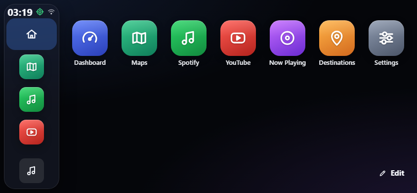
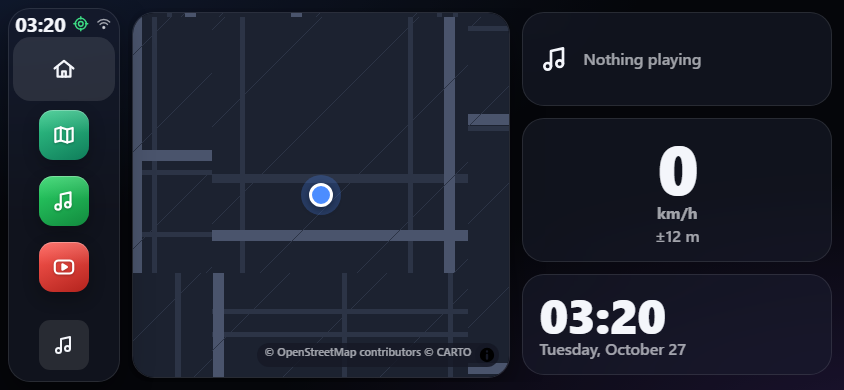
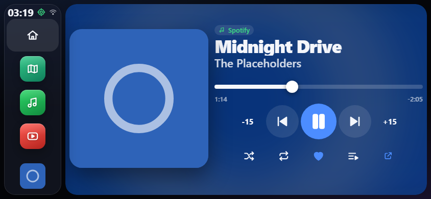

# DriveDeck

An installable in-car dashboard for your iPhone, built as a Progressive Web App. Mount the phone on the dash, add it to the Home Screen, and get a dark, glanceable, big-button interface: a paged Home screen, a dashboard with map / speed / weather / Now Playing widgets, a Spotify remote, a YouTube player, and one-tap hand-off to Apple Maps, Google Maps or Waze.

It is **not** a replacement for a head unit and it is **not affiliated with Apple, Spotify or Google**. The UI is original (own icons, system font) and deliberately uses no Apple branding.

| Home                                               | Dashboard                                                        | Now Playing                                                             |
| -------------------------------------------------- | ---------------------------------------------------------------- | ----------------------------------------------------------------------- |
|  |  |  |

More in [docs/screenshots/final](docs/screenshots/final) (portrait 390x844 and landscape 844x390 for every screen).

## Contents

1. [What you get](#what-you-get)
2. [Read this first: platform limits](#known-limitations)
3. [Quick start (development)](#quick-start-development)
4. [Create the Spotify app](#1-create-a-spotify-app)
5. [Create the Google OAuth client (YouTube)](#2-create-a-google-cloud-oauth-client-youtube)
6. [Deploy](#deploy)
7. [Install on iPhone](#install-on-iphone)
8. [Using it in the car](#using-it-in-the-car)
9. [Settings](#settings)
10. [Architecture](#architecture)
11. [Testing](#testing)
12. [Privacy and data](#privacy-and-data)
13. [Troubleshooting](#troubleshooting)

## What you get

- **Layout chassis** for portrait and landscape: side rail (left / right / bottom) with clock, GPS and connectivity status, Home button, pinned apps and a mini player; in portrait a status bar on top and a dock at the bottom. Safe-area insets respected, 64 px minimum touch targets (configurable up to 96 px).
- **Home**: paged icon grid, edit mode (long-press, drag to reorder, show/hide), custom shortcuts to any URL or scheme (`tel:`, `sms:`, `waze://` ...).
- **Dashboard**: map, Now Playing, speed, clock, weather (Open-Meteo, no key), recent destinations, quick actions. Choose and reorder them.
- **Now Playing**: huge artwork (rounded / square / vinyl), scrubber, transport, shuffle, repeat, like, queue, source badge. Works with Spotify, YouTube and a silent demo player.
- **Spotify** (remote control of the Spotify app): playlists, Liked Songs, recently played, albums, shuffle play, infinite scroll with caching.
- **YouTube**: your playlists, liked videos, search, or paste a link; plays in the official visible IFrame player. Blocked while the car is moving by default.
- **Sport mode**: an on/off mode with synthesised engine, turbo and exhaust sounds that follow your real GPS speed and acceleration. 13 engine types (inline-4, inline-6, flat-6, V6, V8, flat-plane V8, V10, V12, supercharged "Hellcat" V8, rotary, diesel, a deep hoarse growl and a calm quiet one), 6 turbo characters (classic whistle, whoosh inhale/exhale, flutter "stu-tu-tu", twin, race, subtle) and 4 exhaust styles (popcorn, burble, bangs, crackle). Engine sound, turbo whistle and exhaust pops switch on and off separately, each with its own volume, and pops can fire on hard acceleration, on lift-off or both. A simulated gearbox gives the revs a real shape; a turbo spools up while you accelerate and blows off when you lift. "Test sound" plays a scripted drive so you can choose while parked. Two speed sources: **GPS only** (the iPhone delivers a speed about once a second, so hard acceleration is noticed up to a second late) or **Accelerometer + GPS** (reacts within a fraction of a second; GPS keeps the speed accurate). The accelerometer needs iOS motion access and learns how the phone sits in its mount from a few firm accelerations in a straight line; until then, and whenever the sensor is refused or silent, GPS alone is used. GPS runs at maximum precision (freshest fix, no cached positions) while sport mode is on.
- **Maps**: MapLibre map (OpenStreetMap-based tiles), locate-me, search with autocomplete (Photon / Nominatim / Google Places), destination sheet, favorites (Home, Work, custom), recents, hand-off to your navigation app, or in-app turn-by-turn with open-source routing and toll avoidance.
- **Driving lock**: above a speed threshold the keyboard is disabled and a "Parked? Passenger mode" prompt appears; YouTube video pauses behind a "Parked-only" screen.
- **Settings**: over 80 options in 7 sections with search, live preview where visual, JSON export/import.
- **Diagnostics** screen, **Known limitations** screen, first-run **onboarding**, iOS **install guide**, offline app shell and an "update available" prompt.

## Known limitations

The same list is in the app under **Settings > About > Known limitations**. These are limits of iOS web apps and of the services, not bugs; each has the best available fallback.

1. **Steering-wheel buttons.** iOS sends Bluetooth media keys to whichever app owns "Now Playing"; a web app cannot intercept them.
   - **Spotify mode:** the Spotify app plays the audio. DriveDeck only calls the Spotify Web API and deliberately **never plays silent audio and never sets `navigator.mediaSession`**, so the buttons keep working natively. This is enforced by a test.
   - **YouTube mode (and any audio DriveDeck plays itself):** one module, [`src/services/mediaSession`](src/services/mediaSession/index.ts), owns the Media Session (metadata with artwork, playback state, play / pause / previous / next / seek backward / seek forward / seek to / stop) and releases it when Spotify becomes active. It only takes the keys once a video is actually loaded. iOS still decides how media keys behave for a video inside a web page, so they may not always respond.
2. **Spotify:** playback control needs a **Premium** account and the Spotify app running on the iPhone. The Web Playback SDK does not work on iOS, so DriveDeck cannot play Spotify audio itself. If no device is active, DriveDeck shows an "Open Spotify" prompt (`spotify://`) and retries transferring playback automatically. Free accounts get a clear message. iPhone's Spotify does not accept remote volume changes, so the volume slider is hidden there. Spotify apps in development mode are limited to a few users and need a Premium owner (Spotify's rule since February 2026).
3. **iOS web-app limits:** no orientation lock (pick a layout in Settings instead), no Fullscreen API (the installed app already runs without browser bars), no guaranteed background audio, no Battery or Vibration API (those settings are feature-detected and hidden). Wake Lock is used to keep the screen on and re-acquired when the app returns to the foreground.
4. **Navigation:** Apple Maps, Google Maps and Waze cannot be embedded, so DriveDeck hands the destination over by deep link and restores the exact screen when you come back (the router stack is persisted). Choose **DriveDeck (open source)** as the navigation app and it guides you itself: a route line, the next turn, distance / time / arrival, optional spoken directions, rerouting when you leave the route, and "avoid toll roads / motorways". It uses the public Valhalla routing service (OpenStreetMap data, no key). It only works while DriveDeck is open on screen (iOS stops GPS for web apps in the background), has no live traffic, speed limits or lane guidance, and voice prompts can briefly interrupt Spotify. If iOS closes the app, the trip resumes on the next launch. Google Maps links also carry the toll / motorway preference; Waze and Apple Maps use their own settings.
5. **YouTube:** the official IFrame Player API only, kept visible and unmodified (at least 200 px); it only plays while DriveDeck is on screen; no audio extraction. "YouTube while moving" is **Blocked** by default (pause + overlay), with a passenger override that needs confirmation. Search costs 100 quota units, so results are cached.
6. **Signing in inside the home-screen app:** iOS keeps Safari and the installed app in separate storage and OAuth redirects/pop-ups inside an installed web app are sometimes blocked. Fallback for Spotify: sign in via Safari, copy the **connection code** from Settings > Accounts and paste it in the installed app (only the refresh token travels). Google tokens last about an hour and are renewed silently.
7. **Location and the driving lock:** speed comes from GPS and can be late or missing in tunnels (the lock stays on without a signal). The lock is a convenience, not a certified safety system, and cannot know who is holding the phone.
8. **Map data:** default road maps are VersaTiles vector styles (OpenStreetMap data, no key), satellite is Esri. Heavy use may call for your own tile provider. Nominatim forbids search-as-you-type, so it is submit-only. Google Maps / MapKit and the traffic layer need your own key/token. Only tiles you already viewed work offline.

## Quick start (development)

Requirements: Node.js 22 or newer.

```bash
npm install
cp .env.example .env      # then fill in the client IDs (see below)
npm run dev               # http://127.0.0.1:5173
```

> Use **127.0.0.1**, not `localhost`: Spotify only accepts loopback IP redirect URIs.

Useful URL parameters (handy for bookmarks and tests): `?demo=1` turns on the silent demo player, `?screen=<home|dashboard|nowplaying|spotify|youtube|maps|destinations|settings|diagnostics|limitations|install>` opens a screen directly, `?skipOnboarding=1` skips the first-run flow.

Scripts: `npm run build`, `npm run preview`, `npm run lint`, `npm run format`, `npm test`, `npm run e2e` (smoke + touch-target audit), `npm run e2e:pwa` (production build, offline, manifest), `npm run shots` (screenshots), `npm run icons` (regenerate PWA icons).

No credentials are stored in the repo. Client IDs come from `.env` (`VITE_SPOTIFY_CLIENT_ID`, `VITE_GOOGLE_CLIENT_ID`) or can be entered at runtime in Settings > Accounts and data. API keys (Google Maps, MapKit, YouTube) are entered in Settings and stay in your phone's local storage only.

### 1. Create a Spotify app

1. Go to the [Spotify Developer Dashboard](https://developer.spotify.com/dashboard) and log in (the account must have **Premium** for development-mode apps).
2. **Create app**. Name and description are free text. For "Which API/SDKs are you planning to use?" tick **Web API**.
3. **Redirect URIs**, add both (Spotify requires an exact match, including the trailing slash):
   - your production HTTPS URL, e.g. `https://drivedeck.pages.dev/` (for GitHub Pages with a sub-path: `https://you.github.io/drivedeck/`)
   - `http://127.0.0.1:5173/` for local development
4. Save, then open **Settings** and copy the **Client ID**. DriveDeck uses Authorization Code with PKCE, so there is **no client secret** to copy or keep.
5. Put the Client ID in `.env` as `VITE_SPOTIFY_CLIENT_ID` (or into Settings > Accounts and data > Spotify Client ID override).
6. Under **User Management** add the Spotify account(s) that will sign in (development mode allows only a few).

Scopes requested: `user-read-playback-state`, `user-modify-playback-state`, `user-read-currently-playing`, `user-read-recently-played`, `user-library-read`, `user-library-modify`, `playlist-read-private`, `playlist-read-collaborative`, `user-read-private`.

### 2. Create a Google Cloud OAuth client (YouTube)

1. Open the [Google Cloud Console](https://console.cloud.google.com/), create a project.
2. **APIs & Services > Library**: enable **YouTube Data API v3**.
3. **OAuth consent screen**: user type External, fill in the app name and contact email, add the scope `.../auth/youtube.readonly`, and add your Google account under **Test users** (while the app is in Testing mode).
4. **Credentials > Create credentials > OAuth client ID > Web application**.
   - **Authorized JavaScript origins**: your production origin (`https://drivedeck.pages.dev`, no path, no trailing slash) and `http://127.0.0.1:5173`.
   - No redirect URI is needed: DriveDeck uses the Google Identity Services token flow (pop-up), not a redirect.
5. Copy the **Client ID** into `.env` as `VITE_GOOGLE_CLIENT_ID` (or Settings > Accounts and data).
6. Optional: **Create credentials > API key**, restrict it to the YouTube Data API v3 and to your site, then paste it in Settings > Accounts and data > YouTube API key. With only a key, **search and public playlists** work without signing in.

The default quota is 10,000 units/day; `search.list` costs 100, listing costs 1. DriveDeck caches results (5 min for lists, 1 h for search).

### 3. Optional map providers

- **Google Maps**: enable _Maps JavaScript API_ and _Places API (New)_, create a key restricted to your site, paste it in Settings > Accounts and data > Google Maps API key, then pick Map provider = Google Maps (and, if you like, Search provider = Google Places).
- **Apple MapKit JS**: create a Maps ID and a signed MapKit JS token in your Apple developer account, paste the token in Settings, then pick Map provider = Apple MapKit.

If a provider cannot load (no key, bad token, offline) DriveDeck says so and falls back to the OpenStreetMap map. These two adapters could not be verified against live keys in development; they are isolated behind one interface (`MapAdapter`).

## Deploy

DriveDeck is a static site: build it and host the `dist` folder over **HTTPS** (required for geolocation, service workers and OAuth). The build uses relative asset paths, so it works at a domain root or under a sub-path. Set `VITE_SPOTIFY_CLIENT_ID` and `VITE_GOOGLE_CLIENT_ID` in the host's environment so they are baked into the build.

### Cloudflare Pages

1. Push the repo to GitHub/GitLab. In Cloudflare: **Workers & Pages > Create > Pages > Connect to Git**.
2. Build command `npm run build`, output directory `dist`. Environment variable `NODE_VERSION=22`.
3. Add `VITE_SPOTIFY_CLIENT_ID` and `VITE_GOOGLE_CLIENT_ID` under **Settings > Environment variables**.
4. Deploy. The included [`public/_headers`](public/_headers) sets no-cache for the service worker/shell and a referrer policy YouTube needs.
5. Put the resulting `https://<name>.pages.dev/` URL into the Spotify redirect URIs and the Google authorized origins.

### Netlify

1. **Add new site > Import from Git**. The included [`netlify.toml`](netlify.toml) sets the build command and `dist`.
2. Add the two variables under **Site configuration > Environment variables**, deploy, then register the `https://<name>.netlify.app/` URL as above. `public/_headers` is honoured by Netlify too.

### GitHub Pages

1. Repository **Settings > Pages > Source: GitHub Actions**.
2. **Settings > Secrets and variables > Actions > Variables**: add `VITE_SPOTIFY_CLIENT_ID` and `VITE_GOOGLE_CLIENT_ID`.
3. Push to `main`; [`.github/workflows/static.yml`](.github/workflows/static.yml) builds and deploys. Your URL is `https://<user>.github.io/<repo>/`; use exactly that (with the trailing slash) as the Spotify redirect URI, and `https://<user>.github.io` as the Google origin.
4. GitHub Pages ignores `_headers`; that is fine, the app still works (updates may take a little longer to appear because of CDN caching).

## Install on iPhone

1. Open the deployed URL in **Safari** (installing does not work from in-app browsers).
2. Tap **Share**, then **Add to Home Screen**, then **Add**.
3. Launch DriveDeck **from the Home Screen icon** and allow location "While Using the App".
4. Walk through the onboarding (location, optional Spotify / YouTube sign-in, rail position).

The same steps are shown in the app (onboarding and Settings > About > Install on iPhone).

## Using it in the car

- Set Auto-Lock to **Never** (Settings > Display & Brightness); DriveDeck also asks iOS to keep the screen awake while it is open.
- Turn on **Rotation Lock** in Control Center if the layout should not flip in the mount, and pick _Orientation preference_ in DriveDeck instead.
- Start Spotify once before driving so DriveDeck can find a device. If the phone is playing through the car's Bluetooth, the steering-wheel buttons keep controlling Spotify.
- Keep the phone charging and out of direct sun.

## Settings

Seven sections, every item persisted, searchable from the top of Settings, and visual options change the live UI immediately (Appearance also has a preview card). The menu is generated from [`src/core/settingsSchema.ts`](src/core/settingsSchema.ts):

- **Appearance**: theme (dark / light / auto by sunset / follow system), 12 accent presets + custom picker, wallpaper (solid, 8 gradients, blurred album art, uploaded image with dim and blur), icon shape and size, labels, grid columns, UI scale 80-140 %, font weight, text size, corner radius, glass blur, animation speed, page transition, clock format / seconds / date, rail position and width, dock items.
- **Layout**: orientation preference, dashboard widgets (choose / order / split), home pages (order / hide), custom shortcuts, start screen, idle return to Home.
- **Media**: default source, auto-resume, seek step, previous-button behaviour, shuffle/repeat defaults, Now Playing background and artwork shape, queue/like/progress toggles, volume step, Spotify transfer / device name / poll interval, YouTube autoplay / loop / captions / while-moving policy.
- **Sport mode**: master switch, engine / turbo / exhaust on-off and type, volumes, speed source (GPS or accelerometer + GPS), sensitivity, idle sound, gearbox, GPS precision.
- **Maps**: navigation app (incl. DriveDeck's own guidance), avoid tolls / motorways, voice guidance, auto hand-off, map provider and style, north-up or heading-up, auto-zoom by speed, traffic, speed and distance units, speed widget and alert, search provider and region, favorites, recents limit and clear, GPS accuracy.
- **Driving and safety**: keep awake, night dim (level + schedule), typing lock and threshold, passenger override, large touch targets (64-96 px), simplified mode, tap sounds, haptics (hidden where unsupported).
- **Accounts and data**: connect / disconnect, token status, API keys, export / import / reset, clear caches.
- **About**: version, known limitations, diagnostics, install guide.

Strings live in [`src/locales/en.json`](src/locales/en.json) plus the schema; the app uses `react-i18next`, so a Turkish pack is a copy of those keys (see `src/core/i18n.ts`).

## Architecture

```
src/
  core/        settings store (zustand + persist), theme engine, stack router, feature detection,
               logger, driving lock, cache, sunrise maths, PWA registration, settings schema
  services/
    media/       MediaController interface, active-source manager, demo controller
    mediaSession/ the ONLY module that touches navigator.mediaSession
    spotify/     PKCE auth, API client (429 / 401), endpoints, SpotifyRemoteController (polling)
    youtube/     Google Identity Services, Data API + cache, IFrame wrapper, YouTubePlayerController
    maps/        geocoding, deep links, geolocation watcher (speed), favorites, hand-off,
                 MapLibre / Google / MapKit adapters
    weather.ts   Open-Meteo        wakeLock.ts   re-acquires on visibilitychange
  ui/          components, screens, widgets, settings editors, hooks
```

Key decisions (full list in [PLAN.md](PLAN.md)):

- **`MediaController`** (`play`, `pause`, `next`, `previous`, `seek`, `setVolume`, `state$` ...) has `SpotifyRemoteController`, `YouTubePlayerController` and a silent `DemoController`. The Now Playing UI binds to whichever is active.
- **Media key ownership follows the source**: switching source pauses the old one and re-syncs the Media Session; Spotify releases it.
- **One persistent YouTube player host** moves over a placeholder on the YouTube / Now Playing screens and shrinks to a visible mini player elsewhere, so audio survives navigation inside the app.
- **Stack router** with push / pop animations; the stack is persisted so a hand-off (Maps, Spotify) returns to the same screen within 30 minutes.
- **Units** are stored in km/h and metres and converted for display.

## Testing

```bash
npm test            # 177 unit tests: PKCE, API retry/429, router, settings, media session ownership,
                    # parked-only gate, schema integrity, search, deep links, i18n key coverage ...
npm run e2e         # Playwright (Chromium, iPhone-sized, touch): smoke flows + a touch-target audit
                    # that walks every screen and checks every control is at least 64 px
npm run e2e:pwa     # against the production build: manifest, icons, offline reload, no debug hook
npm run shots       # screenshots at 390x844 and 844x390 into docs/screenshots/latest
```

External services (Spotify, YouTube, tiles, search, weather) are stubbed in the e2e tests so they are deterministic and need no accounts.

## Privacy and data

Everything stays on the phone: settings, favorites, recents, tokens and API keys live in `localStorage`; there is no DriveDeck backend. Requests go directly from the phone to: Spotify, Google / YouTube, VersaTiles / Esri map servers, Photon or Nominatim (search text and your approximate position for ranking), Valhalla at valhalla1.openstreetmap.de (your position and the destination, only when you plan a DriveDeck route), Open-Meteo (rounded coordinates), and optionally Google Maps / Apple MapKit. Location is used only on the device and in those requests.

Attribution: Maps (c) OpenStreetMap contributors, VersaTiles, Esri. Routes by Valhalla (FOSSGIS). Search by Photon / Nominatim. Weather by Open-Meteo. Spotify and YouTube are trademarks of their owners; Spotify content links back to Spotify ("Open in Spotify"), Spotify artwork is never cropped into a vinyl circle, and the YouTube player is never altered.

## Troubleshooting

| Symptom                                              | Fix                                                                                                                                       |
| ---------------------------------------------------- | ----------------------------------------------------------------------------------------------------------------------------------------- |
| Spotify: `INVALID_CLIENT: Invalid redirect URI`      | The redirect URI in the dashboard must equal the page URL exactly (scheme, host, path, trailing slash). Use `127.0.0.1`, not `localhost`. |
| Spotify sign-in does not return to the installed app | Sign in using Safari, copy the connection code in Settings > Accounts, paste it in the installed app.                                     |
| "Open Spotify" never goes away                       | Open the Spotify app and start any song once; DriveDeck retries every few seconds and when it comes back to the foreground.               |
| "Spotify Premium required"                           | Remote control is a Premium feature. Spotify itself and the steering-wheel buttons still work.                                            |
| YouTube: nothing in Playlists                        | Sign in, or add a YouTube API key and use Search / Link.                                                                                  |
| YouTube sign-in pop-up does not open                 | Common inside the home-screen app. Use an API key for search, or sign in from Safari first.                                               |
| Map is blank or grey                                 | Offline or tile server blocked; previously viewed areas stay cached. Check Settings > Maps > Map provider.                                |
| Typing is blocked in a parked car                    | GPS speed is above the lock threshold or the fix is stale. Settings > Driving and safety, or use Passenger mode.                          |
| New version does not show up                         | Close and reopen the app; an "update available" banner appears when the worker has the new files.                                         |
| Screen locks while driving                           | Set Auto-Lock to Never; check Settings > Diagnostics > Wake lock.                                                                         |
